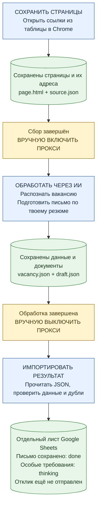

# Обработка вакансий предприятий

**Реализованы сохранение HTML (`collect-html`), распознавание (`process-html`) и письмо по резюме (`draft-html`). Доступен импорт (`import-results`). Адаптация резюме и отправка внешних откликов ещё предстоят.**

Сценарий разделён на три запуска: **сохранить страницы → обработать через ИИ → импортировать результат**. Все три запуска доступны; адаптация резюме и автоматическая отправка пока остаются в плане.
Прокси переключаешь вручную после завершения предыдущего запуска.

На схеме: **синий — действие программы**, **зелёный — сохранённые данные**,
**жёлтый — твоё ручное действие**. Стрелки показывают порядок выполнения.

## Что происходит в каждом запуске

| Запуск | Вход | Что происходит | Результат | Скрипт и пункт плана |
|---|---|---|---|---|
| Сохранение страниц | Полные URL из колонок Ссылка и Статус; выбираются пустые статусы | Chrome открывает страницы, программа сохраняет DOM и адреса; таблица не меняется | `HTML_DIR/<ключ>/page.html` и `source.json` | `workflows/collect_html.py` / `run.py collect-html` — пункт 18, реализовано |
| Обработка через ИИ | Сохранённые страницы и твоё исходное резюме | ИИ извлекает поля вакансии, затем готовит письмо и анализ; программа проверяет JSON | `vacancy.json` и `draft.json` | `workflows/process_html.py`: `process-html` — пункт 19, `draft-html` — пункт 15 |
| Импорт | Оба проверенных JSON-файла | Программа проверяет ключ вакансии и дубли, записывает готовые данные в отдельный лист | Строка Google Таблицы со статусом `done` или `thinking` | `workflows/import_results.py` / `run.py import-results` — пункт 20, на проверке |

## Что лежит в файлах

| Файл | Содержимое |
|---|---|
| `page.html` | Полный текст `driver.page_source` после пауз и прокрутки; отдельные iframe и shadow DOM не собираются |
| `source.json` | Версия, ключ SHA-256 исходного URL, исходный и конечный адреса, время снимка и хеш HTML |
| `vacancy.json` | Те же поля, что у hh: ID, Компания, Компания ссылка, Заголовок, Зарплата, Описание, Ссылка. Контакты hr и Комментарий — если обнаружены |
| `draft.json` | Исходная вакансия, письмо, подводные камни, оценка и специальные требования; модель и время подготовки |

Сохранённые файлы связывают этапы: их можно передать на другой ПК.
Чтобы заново сформировать письмо, повторно открывать сайт предприятия не требуется.
Оригиналы HTML и резюме сохраняются. Готовые снимки при повторе проверяются и пропускаются без навигации;
повреждённые вызывают ошибку без перезаписи. Параметры URL и `#` сохраняются.
Строки с непустым статусом, включая `done`, сборщик HTML не обрабатывает.

`done` означает успешную обработку ИИ и сохранённое готовое сопроводительное письмо; отклик ещё не отправлен.
Отправка работодателю — отдельное действие, сначала вручную. Только подтверждённая отправка позволяет поставить `wait`;
текущий автоматический отправщик работает только с hh, внешние отклики отправляются вручную.
