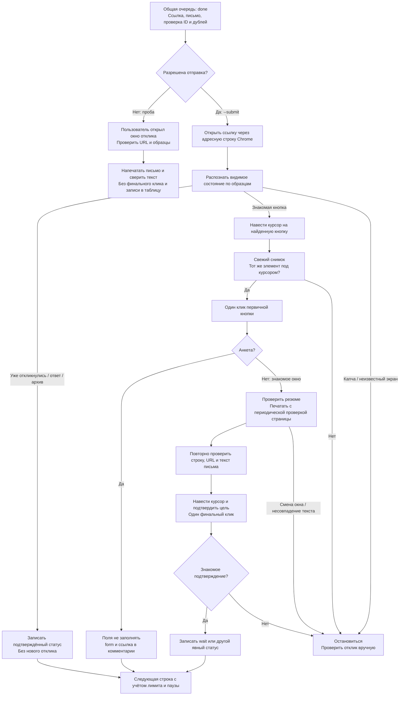

# Экранный режим отклика

Запуск: `Scripts/run.py desktop-send`. Прежний Selenium-отправщик остаётся отдельной командой `send`.

Мышь и клавиатура работают через ОС, без DOM, WebDriver и порта отладки.
Образцы привязаны к размеру Chrome и масштабу; они находятся только в `data/desktop/`.
Перед действием проверяется активное окно, затемнённые элементы не кликаются.
Капча решается вручную; новый режим не гарантирует отсутствие проверок со стороны hh.
