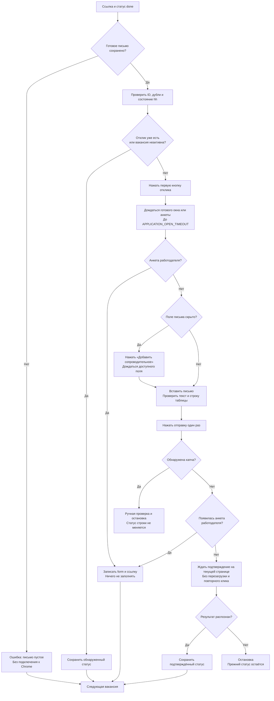

# Отправка готовых откликов на hh

Запуск: `Scripts/run.py send`. Письмо берётся из той же строки таблицы.
Используется уже выбранное в окне hh резюме.

`done` означает успешную обработку ИИ и сохранённое готовое сопроводительное письмо; отклик ещё не отправлен.
Пустой статус и `new` не входят в отправку даже с письмом. До сохранения результата остаётся `done`.
Отдельная команда `ai` готовит письмо: без специальных требований ставит `done`,
с требованиями — `thinking` для ручной проверки. После одобрения пользователь ставит `done`.
Параметр `--start-row` задаёт нижнюю границу строк; `--limit` ограничивает новые подтверждённые отправки.
Неизвестный экран или ошибка после начала попытки останавливают запуск.
При капче повторяется `Duck.mp3`; после ручной проверки запуск завершается,
не записывая `form` и не меняя статус текущей строки.
При перезапуске снова проверяется состояние hh: обнаруженные `wait`, `reject`, `invite`,
`archive` или `unavailable` сохраняются без нового клика отправки.
Если hh не показывает предыдущий отклик, возможна повторная отправка.
Несколько отправщиков одновременно не запускаются.

## Подтверждение и ограничения

`hh/application_result.py` ждёт результат после прежней паузы; максимум задаёт
`APPLICATION_RESULT_TIMEOUT`. Чтение `read_current_response` не открывает страницу.
Подтверждение «Резюме доставлено» ищется только в блоке отклика проверенной вакансии.
Служебное окно города не даёт `form`; дополнительные поля проверяются в окне отклика.

При тайм-ауте или капче после финального клика отклик мог уйти, хотя `done` ещё
не сменился на `wait`. Запуск останавливается; перед повтором нужна ручная сверка.
Команда `check` проверяет только `wait`. Старые ошибочные `form` автоматически не меняются.

Новая последовательность проверена локально на сценариях с доставкой, окном города,
анкетой, капчей и неизвестным результатом. Реальный прогон на hh остаётся.
