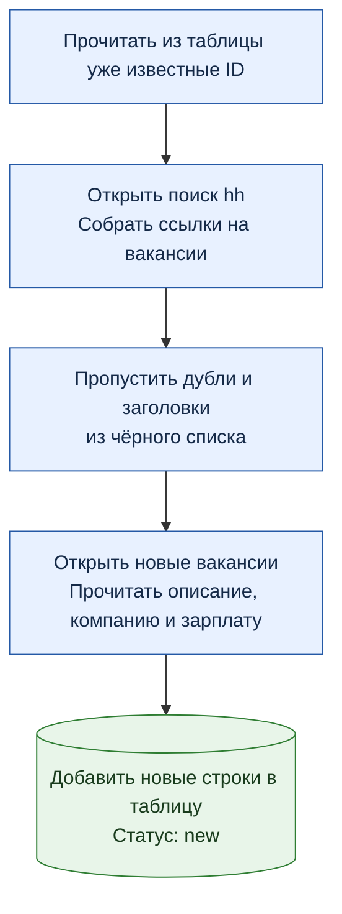
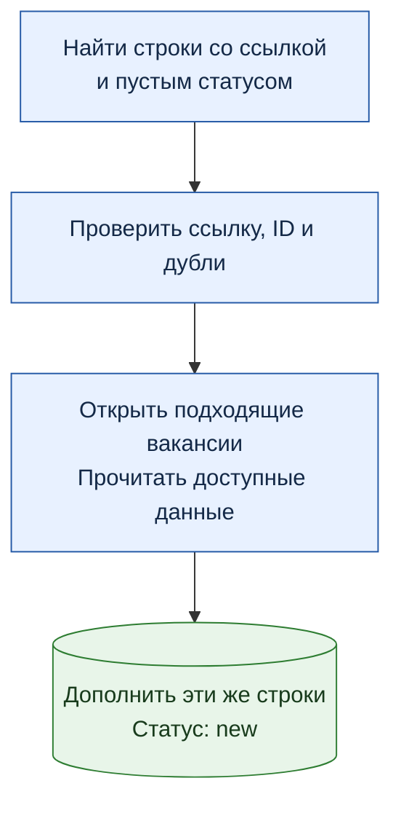
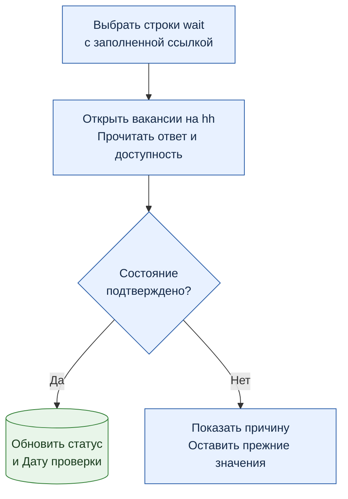
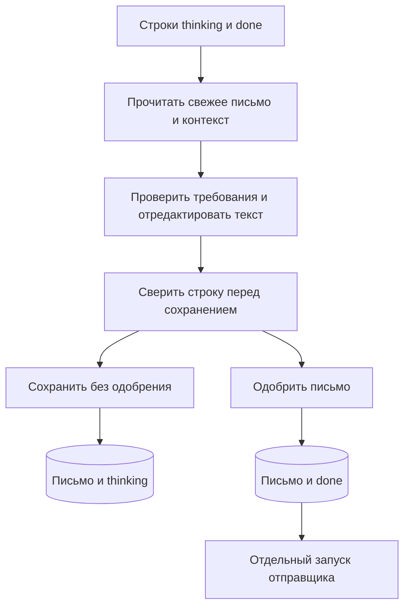

# Как сейчас работает сборщик hh

Выбираешь нужный режим и запускаешь его отдельно.
Режимы обмениваются данными через Google Таблицу.
Отправка готовых писем показана отдельно: [отправщик откликов](hh_applications.md).

На схемах: **синий — действие программы**, **зелёный — данные в таблице**.

## Собрать новые вакансии из поиска

Запуск: `Scripts/run.py search`.

Результат: новые строки. Уже существующие вакансии этот режим не дополняет.

## Заполнить вакансии по добавленным ссылкам

Запуск: `Scripts/run.py fill`.

Результат: заполнены пустые ячейки исходных строк. Ручные значения и формулы
сохраняются; ссылка очищается. Дубли и несовпадающие ID пропускаются.
Строки с любым непустым статусом в этот режим не попадают.

## Проверить ответы на отправленные отклики

Запуск: `Scripts/run.py check`.
В Chrome должен быть открыт аккаунт, с которого отправлены эти отклики.
Доступны `--start-row`, `--limit`, `--checked-from`, `--checked-to`, `--include-unchecked`.
Даты относятся к последней проверке, обе границы включены. Строки без даты добавляются
к заданному диапазону отдельной галочкой; без диапазона дата отбор не ограничивает.

Что записывается в таблицу:

| Поле | Возможный результат |
|---|---|
| Статус | `wait` — ответа пока нет; `reject` — отказ; `invite` — приглашение; `archive` — архив; `unavailable` — вакансия недоступна аккаунту |
| Дата проверки | Локальное время последнего распознанного результата |

Архив сам по себе не означает отказ: если явного ответа нет, ставим `archive`.
Сообщение «Вам недоступна эта вакансия» даёт `unavailable`, и очередь продолжается.
Явные `reject` и `invite` сохраняются и на архивных страницах.
Повторно проверяются только строки `wait`; дата обновляется и при прежнем `wait`.
При неизвестном состоянии прежние значения сохраняются.
Перед записью повторно проверяются ID, ссылка, статус и дата проверки.

## Где находится общий код

| Что делает программа | Модули |
|---|---|
| Читает вакансию и сохраняет данные в двух первых режимах | `hh/vacancy_processor.py` и `hh/vacancy_reader.py` |
| Открывает вакансию или читает ответ на текущей странице | `hh/response_reader.py` |
| Ждёт подтверждение отправки без перезагрузки | `hh/application_result.py` |
| Читает и изменяет Google Таблицу | `tables/sheets.py`; результат проверки ответа — `tables/response_sheet.py` |
| Проверяет ID, ссылки и дубли | `tables/duplicates.py` и `core/utils.py` |

Схемы показывают успешный путь одной вакансии. Ошибки отдельной строки
или соединения обрабатываются согласно режиму; отклики эти скрипты не отправляют.
Если hh показывает капчу, текущий запуск останавливается со звуковым сигналом;
статус обрабатываемой строки не меняется.

## Проверить письмо вручную

В интерфейсе: «Просмотреть письма» → «Показать очередь» → «Открыть письмо».

При изменении вакансии или письма запись отменяется. Редактор не отправляет отклик;
остальные статусы можно открыть только для чтения.
