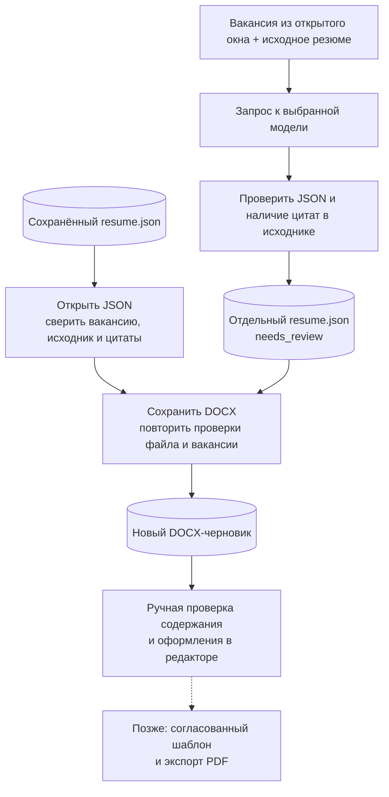

# Подготовка резюме и документов

В окне письма создайте черновик через «Резюме → JSON» или выберите «Открыть JSON», затем «Сохранить DOCX».
Для запроса к ИИ используется общий файл настроек; экспорт DOCX работает локально.

В DOCX входят тексты разделов. Вопросы, цитаты и пояснения остаются в JSON для проверки.
Верная цитата не гарантирует точности новой формулировки: проверяйте даты, компании и факты вручную.
Сборщик документов не меняет Google Таблицу и не отправляет отклик.
