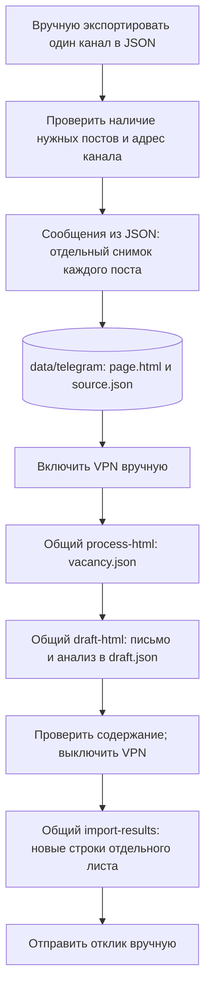

# Обработка вакансий Telegram

[Инструкция](../Docs/telegram.md) · [План, пункт 31](../PLAN.md)

Получение сообщений из сети пока не реализовано. Посты не отправляются работодателям автоматически.
Формат JSON, паузы ИИ, проверка цитат и импорт партиями общие с сайтами компаний.
